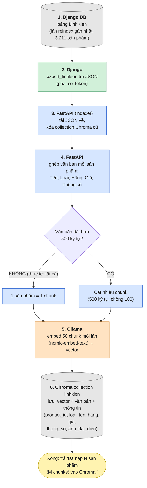
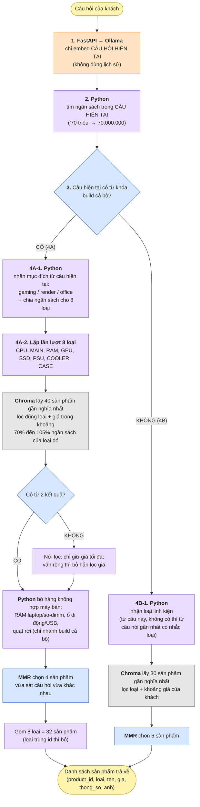
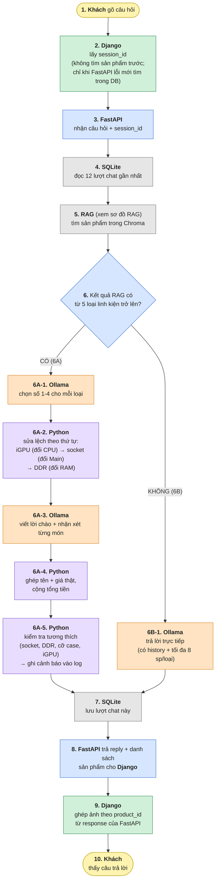

# Luồng hoạt động A–Z của chatbot tư vấn linh kiện

**Những chỗ đã sửa so với bản trước (27/11/2026):** `retrieve()` chỉ đọc câu hỏi hiện tại (không dùng lịch sử để embed, tìm ngân sách hay nhận mục đích); bảng tỷ lệ ngân sách sửa theo đúng code (hai nơi `retriever.py` và `system_prompt.txt` hiện giống hệt nhau); `resolve` sửa lệch theo thứ tự iGPU → socket → DDR; `/chat` trả thêm mảng `products`; `/reindex` báo cả số sản phẩm lẫn số chunk; thêm global exception handler và endpoint `POST /compatibility`; Django ghép ảnh theo `product_id` (đang chờ sửa nốt lỗi thụt lề, xem mục 7.4).

**Bổ sung sau khi đọc zip `chatbot_api-23a6c813` (27/11 ~11:40):** bước 4 (exception handler) và bước 5 (`compatibility.py` + `POST /compatibility`) đã có trong code thật; tuning ngân sách lúc 10:55 — tỷ lệ cộng đúng 100% ở cả 3 profile (xem mục 3 và 7.5); `indexer.py` đã lưu đúng bản trả tuple (số chunk, số sản phẩm).

**Tóm tắt một câu:** Khách hỏi → Django lấy `session_id` rồi chuyển sang FastAPI → FastAPI đọc lịch sử, tìm sản phẩm bằng RAG (Chroma) chỉ từ câu hỏi hiện tại, rồi hoặc để AI chọn bộ linh kiện và Python ghép giá/tổng tiền (hỏi build cả bộ), hoặc để AI trả lời trực tiếp (hỏi thường) → kiểm tra tương thích → lưu lịch sử → Django ghép ảnh theo `product_id` → khách thấy câu trả lời.

---

## 1. Các thành phần

| Thành phần | Vai trò | Giữ gì |
|---|---|---|
| **Trình duyệt** (`store.js`) | Khung chat, hiển thị reply | Giao diện |
| **Django** (`views.py`) | Cổng vào/ra, nguồn dữ liệu gốc, ghép ảnh | DB `LinhKien`, Django session |
| **FastAPI** (`main.py`, `rag/`, `prompting.py`, `compatibility.py`, `ollama_client.py`) | Bộ não: lịch sử, RAG, prompt, gọi AI, kiểm tra tương thích | Chroma, SQLite lịch sử |
| **Ollama** | Chạy 2 model: `nomic-embed-text` (embed) và `qwen3-sale` (chat) | Model |
| **ChromaDB** (`chroma_db/`) | Kho vector, collection `linhkien`, đo độ gần bằng cosine | Vector + thông tin sản phẩm |
| **SQLite** (`data/chat_history.sqlite3`) | Lịch sử chat theo `session_id` | Các lượt user/assistant |

Màu trong các sơ đồ: vàng = khách/kết quả, xanh lá = Django, xanh dương = FastAPI, cam = Ollama (AI), tím = Python tự xử lý, xám = nơi lưu dữ liệu.

---

## 2. Sơ đồ 1: Xử lý dữ liệu (nạp sản phẩm vào Chroma)

Chạy khi bạn gọi `POST /reindex` (sau khi thêm/sửa sản phẩm). Chroma không tự cập nhật.

**Chú thích**
1. Django DB là nơi giữ dữ liệu gốc. Lần reindex gần nhất có **3.211 sản phẩm**, gồm 9 loại: GPU 601, CASE 583, COOLER 454, SSD 398, PSU 287, MAIN 284, CPU 237, HDD 206, RAM 161. **Lưu ý:** các file CSV đã điền ngày 21/11 cộng lại là 3.232 sản phẩm sau khi xóa các dòng tên hỏng (COOLER 462, PSU 292, RAM 169) — nhiều hơn con số trong DB 21 món. Nếu DB đã import lại từ các file CSV đó thì chạy `/reindex` rồi cập nhật lại các con số ở đây.
2. `export_linhkien` trả JSON `{id, loai, ten, hang, gia_hien_tai, tom_tat, anh_dai_dien}`, bắt buộc có header `Authorization: Token <EXPORT_TOKEN>`.
3. FastAPI tải JSON về rồi **xóa sạch collection cũ** trước khi nạp (nên reindex là nạp lại toàn bộ). Nếu tải JSON thất bại hoặc export rỗng thì không xóa gì cả, Chroma giữ dữ liệu cũ.
4. Mỗi sản phẩm được ghép thành một đoạn văn: `Tên sản phẩm / Loại / Hãng / Giá / Thông số`. Trường `thong_so` lấy từ `tom_tat` của Django.
5. Chỉ khi đoạn văn dài hơn 500 ký tự mới bị cắt nhiều chunk. Thực tế trong DB của bạn **mọi sản phẩm đều đúng 1 chunk** (3.211 chunk = 3.211 sản phẩm).
6. Ollama embed theo lô 50 chunk, mỗi chunk thành một vector. Chroma lưu vector + văn bản + thông tin (`product_id, loai, ten, hang, gia, thong_so, anh_dai_dien, chunk_idx`). `/reindex` trả về cả hai số: số sản phẩm và số chunk.

---

## 3. Sơ đồ 2: RAG (tìm sản phẩm cho một câu hỏi)

Đây là hàm `retrieve()` trong `rag/retriever.py`. Từ 27/11/2026, hàm này **chỉ đọc câu hỏi hiện tại** — không dùng lịch sử để embed, tìm ngân sách hay nhận mục đích (xem mục 7.1).

**Chú thích**
- **Bước 1:** văn bản đem đi embed là **chỉ câu hỏi hiện tại** (`query_text = message`), embed 1 lần cho cả quá trình. Trước đây từng ghép thêm 4 tin gần nhất trong lịch sử — đã bỏ từ 27/11 vì lịch sử làm câu hỏi sau bị nhiễm ngữ cảnh của câu trước (ví dụ hỏi "ram 16gb giá bao nhiêu" lại trả về RAM ~9 triệu vì dính ngân sách 8–10 triệu của câu hỏi build trước đó).
- **Bước 2:** ngân sách **chỉ đọc từ câu hiện tại** (`extract_budget(message)`). Hiểu "70 triệu", "tầm 70", "dưới 50", "50 đổ lại", "từ 30 đến 40 triệu". Số trần từ 1 đến 500 tự hiểu là triệu. "Tầm 70 triệu" cho ra khoảng (56 triệu, 70 triệu), nhưng nhánh build cả bộ chỉ dùng số trần để chia ngân sách.
- **Bước 3:** chỉ xét **câu hiện tại**. Điều kiện là có từ `build` (khớp theo ranh giới từ `\bbuild\b`) hoặc một trong các cụm: cấu hình, lắp máy, một bộ, bộ máy, nguyên bộ, full bộ, cả bộ, toàn bộ, xây dựng, máy tính (cả dạng không dấu). Lưu ý: các cụm trong `is_full_build()` khớp kiểu chuỗi con (substring) — chỉ riêng từ `build` là khớp theo ranh giới từ. Còn khớp theo ranh giới từ (`\b`, qua `_contains_word`) là cách nhận từ khóa profile/mục đích và loại linh kiện, ví dụ "mai" không kích hoạt "ai", "livestream" không khớp "stream", "ram" không khớp "program".
- **4A (build cả bộ):** mục đích lấy **từ câu hiện tại**, xét theo thứ tự gaming → render → office, trúng cái nào trước thì lấy cái đó, không có thì mặc định gaming. Từ khóa gaming: game, chơi game, fps, esport, stream, chơi...; render: render, đồ họa, ai, machine learning, blender, premiere, 3d, workstation...; office: văn phòng, office, làm việc, học, không gpu, igpu, không card... Tỷ lệ ngân sách trong `retriever.py` (đối chiếu ngày 27/11/2026, **giống hệt** bảng trong `system_prompt.txt`):

| Loại | Gaming | Render | Office |
|---|---|---|---|
| GPU | 38% | 35% | 0% (bỏ qua) |
| CPU | 20% | 22% | 30% |
| MAIN | 11% | 11% | 22% |
| RAM | 8% | 12% | 16% |
| SSD | 8% | 8% | 14% |
| PSU | 7% | 6% | 8% |
| COOLER | 4% | 3% | 3% |
| CASE | 4% | 3% | 7% |

  Lưu ý: từ 10:55 ngày 27/11, các tỷ lệ cộng lại đúng 100% ở cả 3 profile (trước đó vượt 100%: gaming 102,5%, render 113%, office 101,5%). Tổng tiền cuối cùng vẫn phụ thuộc vào vị trí giá của món được chọn trong từng khoảng (xem mục 7.5).
  Ví dụ "build máy chơi game tầm 70 triệu": ngân sách trần 70.000.000đ, GPU được 38% = 26.600.000đ nên Chroma chỉ lấy GPU giá từ 18.620.000đ đến 27.930.000đ (70% đến 105%). CPU 20% = 14.000.000đ nên lọc 9.800.000đ đến 14.700.000đ. Cứ thế với 8 loại. Kết quả: 8 loại × 4 = **32 sản phẩm**. Nếu khách không nêu ngân sách thì không lọc giá. Loại nào có tỷ lệ 0% (GPU ở profile office) thì bỏ qua hẳn.
- **4B (hỏi thường):** loại linh kiện nhận theo từ khóa (card, ram, ssd, nguồn...), cũng khớp theo ranh giới từ. Câu này không có loại thì tìm ngược trong lịch sử, lấy từ **câu hỏi gần nhất có nhắc loại** (duyệt ngược các lượt user, lượt nào nhắc loại thì lấy lượt đó; câu gần nhất không nhắc loại thì lùi tiếp), không lấy từ câu trả lời của bot. Lấy 30 sản phẩm gần nhất, MMR chọn **6**. Nhánh này **không** lọc hàng laptop (xem mục 7.6).
- **MMR** chọn sản phẩm vừa sát câu hỏi vừa khác nhau, tránh 4 sản phẩm gần như giống hệt. Hệ số `lambda` 0,75 ở nhánh build cả bộ, 0,5 ở nhánh hỏi thường.
- Nếu Chroma rỗng (chưa reindex) thì trả danh sách rỗng và ghi cảnh báo.

---

## 4. Sơ đồ 3: Luồng chính từ lúc khách hỏi đến output

### Dữ liệu đi qua từng chặng

| Chặng | Giao thức | Gửi đi | Nhận về |
|---|---|---|---|
| 1→2 Trình duyệt → Django | HTTP POST (JSON) | `message` | `{reply}` |
| 2→3 Django → FastAPI `/chat` | HTTP POST (JSON) | `message`, `session_id` | `{reply, model, session_id, products}` |
| 4 FastAPI ↔ SQLite | thư viện | `session_id` | tối đa 12 lượt gần nhất |
| 5 FastAPI → Ollama embed | HTTP POST `/api/embed` | câu hỏi hiện tại | vector |
| 5 FastAPI ↔ Chroma | thư viện | vector + bộ lọc loại/giá | các chunk + thông tin |
| 6 FastAPI → Ollama chat | HTTP POST `/api/chat` | `messages`, `format`, `options` | nội dung AI sinh |
| 9 Django → Trình duyệt | JSON | `{reply}` đã ghép ảnh | hiển thị |

Ngoài luồng chính còn endpoint riêng `POST /compatibility`: gửi `{"product_ids": [...]}` (id sản phẩm trong Django), nhận `{ok, compatible, warnings, products}` — kiểm tra socket, DDR, cỡ case và iGPU của một bộ máy bất kỳ mà không cần qua chat.

### Bước 2: Django
Cắt `message` còn tối đa 1000 ký tự. Lấy `session_id = request.session.session_key` (chưa có thì tạo), mỗi trình duyệt một key — không còn chuyện nhiều khách dùng chung một session. Django **không** tìm sản phẩm trước nữa; `search_products()` (truy vấn ORM) chỉ chạy trong khối `except`, khi gọi FastAPI lỗi, để làm phương án dự phòng.

### Bước 4: lịch sử được dùng ở đâu
Đọc 12 lượt gần nhất. Lịch sử **chỉ** được dùng ở 2 chỗ: (1) nhánh 6B — 6 lượt gần nhất đưa vào prompt; (2) nhánh 4B — khi câu hiện tại không nhắc loại linh kiện thì lấy loại từ câu hỏi gần nhất có nhắc loại. Lịch sử **không** được dùng để embed câu hỏi, tìm ngân sách hay nhận mục đích build (cả 3 thứ đó chỉ đọc câu hiện tại), và nhánh 6A không đưa lịch sử vào prompt của AI.

### Bước 6: rẽ nhánh
Điều kiện là `is_multi_type_build`: kết quả RAG có **từ 5 loại linh kiện trở lên**.

**6A: build cả bộ (hai lần gọi AI, ba lần Python)**
1. **Pick (AI):** prompt riêng "kỹ thuật viên PC", chỉ nhận câu hiện tại + danh sách đánh số `[1]..[4]` cho từng loại. AI chỉ trả JSON 8 số nguyên (`temperature 0.1`, `num_predict 120`, ép theo schema).
2. **Resolve (Python):** đổi số thành sản phẩm thật, rồi sửa lệch theo đúng thứ tự này (thứ tự quan trọng vì đổi CPU có thể đổi socket): **(a) iGPU** — nếu bộ máy không có card rời mà CPU được chọn không có đồ họa tích hợp (Intel dòng F/KF, AMD Ryzen dòng F, Xeon, Threadripper...) thì đổi CPU sang ứng viên có iGPU trong 4 ứng viên; **(b) socket** — nếu CPU và Mainboard lệch socket (AM5/AM4/LGA1700/LGA1851...) thì thay Mainboard bằng cái cùng socket trong 4 ứng viên; **(c) DDR** — nếu Main và RAM lệch DDR4/DDR5 thì thay RAM. Sản phẩm trả về xếp theo thứ tự GPU, CPU, MAIN, RAM, SSD, PSU, COOLER, CASE.
3. **Notes (AI):** dùng `system_prompt.txt` + 8 món đã chốt, trả JSON gồm lời chào, nhận xét ngắn từng món, câu kết (`temperature 0.3`, ép theo schema).
4. **Render (Python):** ghép lời chào + 8 dòng `**Loại:** Tên (giá) – nhận xét` + **Tổng chi phí cộng bằng Python** + câu kết. Nếu AI trả JSON hỏng hoặc lời chào có cụm "chưa bao gồm", "dư ra"... thì dùng câu mặc định.
5. **Compatibility (Python):** `PCCompatibilityService` kiểm tra lại bộ máy đã chốt — socket CPU–Main, DDR Main–RAM, cỡ case (Main có vừa case không) và iGPU (không có card rời thì CPU phải có iGPU) — rồi ghi từng cảnh báo vào log. Đây là kiểm tra độc lập, chỉ cảnh báo chứ không sửa bộ máy nữa. Ngoài ra còn có endpoint riêng `POST /compatibility` để kiểm tra một bộ máy bất kỳ.

**6B: hỏi thường (một lần gọi AI)**
`build_messages`: system prompt + 6 lượt lịch sử (mỗi tin cắt 1000 ký tự) + danh sách sản phẩm (tối đa 8 mỗi loại) + câu hỏi → Ollama `/api/chat` (`temperature 0.4`) → `clean_reply` bỏ khối `<think>`.

### Bước 7 đến 10
Lưu 2 dòng (user + assistant) vào SQLite, mỗi session giữ tối đa 40 dòng. FastAPI trả `{reply, model, session_id, products}` — mảng `products` là đúng các món bot đã dùng (nhánh 6A: bộ máy đã chốt; nhánh 6B: các món đã retrieve), mỗi món có `product_id`, `loai`, `ten`, `gia`, `thong_so`, `anh`. Django ghép ảnh: với mỗi món trong `products`, lấy link `anh` gắn `` xuống cuối reply, trùng `product_id` thì bỏ — **không còn so tên, không còn truy vấn ORM riêng** trên đường đi thành công. Cuối cùng trả `{reply}` và `store.js` hiển thị.

**Đang chờ sửa (27/11):** trong `inject_images_from_products`, hai dòng `if lines:` và `return reply` đang nằm trong vòng `for` nên hàm thoát ngay sau món đầu tiên — thực tế test chỉ hiện 1 ảnh (ảnh GPU, vì món đầu tiên trong danh sách là GPU). Cách sửa: đưa hai dòng đó ra ngoài vòng lặp (thụt 4 khoảng trắng, thẳng hàng với `for`).

---

## 5. Khi có lỗi thì sao

Từ 27/11/2026, mọi lỗi do FastAPI trả về đều theo một khuôn chung: `{"status": "error", "message": "..."}` (giữ nguyên mã HTTP).

| Sự cố | Ai xử lý | Kết quả |
|---|---|---|
| FastAPI tắt, timeout, JSON hỏng | Django (bắt `URLError, TimeoutError, KeyError, ValueError`) | Trả câu dự phòng `rule_reply()`: gợi ý 3 sản phẩm từ DB, không dùng AI |
| `retrieve()` lỗi | FastAPI | `products = []`, vẫn gọi AI (trả lời kém vì thiếu dữ liệu) |
| Chroma rỗng | `retrieve()` | Trả `[]` kèm cảnh báo "hãy gọi /reindex" |
| Ollama tắt, thiếu model, timeout | FastAPI | HTTP 503, khuôn lỗi chung, Django rơi vào câu dự phòng |
| Reply rỗng | FastAPI | HTTP 502, khuôn lỗi chung, Django rơi vào câu dự phòng |
| Dữ liệu gửi lên không hợp lệ (ví dụ thiếu `message`, dài quá 1000 ký tự) | FastAPI | HTTP 422, `{"status": "error", "message": "Dữ liệu gửi lên không hợp lệ."}` |
| Lỗi khác không lường trước | FastAPI | HTTP 500, thông báo chung chung, ghi đầy đủ traceback vào log |
| `/reindex` khi Django tắt | FastAPI | HTTP 500, khuôn lỗi chung, Chroma giữ dữ liệu cũ (chỉ xóa sau khi tải xong) |

Phía Django an toàn với khuôn lỗi mới: không có chỗ nào đọc `data["detail"]`, nên lỗi FastAPI nào cũng rơi vào `rule_reply()` qua khối `except`.

---

## 6. Cấu hình thật (`config.py`)

| Biến | Mặc định | Tác dụng |
|---|---|---|
| `OLLAMA_MODEL` | `qwen3-sale:latest` | Model chat |
| `EMBED_MODEL` | `nomic-embed-text:latest` | Model embed |
| `TEMPERATURE` | 0.4 | Nhiệt độ nhánh chat (pick 0.1, notes 0.3 cố định trong code) |
| `NUM_CTX` | 4096 | Ngữ cảnh (code ép tối thiểu 4096) |
| `MAX_TOKENS` | 2400 | Độ dài tối đa (pick cố định 120) |
| `KEEP_ALIVE` / `TIMEOUT_SECONDS` | 30m / 120 | Giữ model trong RAM / chờ Ollama tối đa |
| `HISTORY_FOR_LLM` | 12 | Số lượt đọc từ SQLite |
| `MAX_HISTORY_TURNS` | 6 | Số lượt đưa vào prompt nhánh 6B |
| `MAX_STORED_MSGS` | 40 | Số dòng tối đa lưu mỗi session |
| `MAX_PRODUCTS` | 8 | Số sản phẩm mỗi loại đưa vào prompt 6B |
| `RAG_TOP_K` / `RAG_FETCH_K` | 6 / 30 | Nhánh 4B: lấy 30, chọn 6 |
| `DJANGO_EXPORT_URL` / `DJANGO_EXPORT_TOKEN` | `http://127.0.0.1:8000/api/linhkien/export/` / (trống) | Nơi lấy dữ liệu để reindex |
| `CHROMA_DIR` / `CHAT_DB_PATH` | `chroma_db` / `data/chat_history.sqlite3` | Nơi lưu |

`system_prompt.txt` được đọc lại **mỗi lần gọi**, sửa file là có hiệu lực ngay, không cần restart. Một số hằng số chỉ nằm trong code (không đổi qua `.env`): 4 sản phẩm mỗi loại và lấy 40 ứng viên ở full build, khoảng giá 70%–105%, `lambda` của MMR (0,75 ở full build, 0,5 ở nhánh thường). Bảng tỷ lệ ngân sách trong `system_prompt.txt` **giống hệt** `BUDGET_PROFILES` trong `retriever.py` (đối chiếu 27/11/2026) — chỉ nhánh 6B mới đọc bảng trong `system_prompt.txt`, nhánh build dùng tỷ lệ của `retriever.py`.

---

## 7. Những điểm cần để ý (rút ra từ code, không phải lỗi bắt buộc phải sửa)

1. **Ngân sách chỉ đọc từ câu hiện tại, ở mọi chỗ.** Từ 27/11, cả `retrieve()` (embed, ngân sách, mục đích) lẫn bước pick đều chỉ đọc câu hỏi hiện tại. Nếu khách nêu ngân sách ở lượt trước rồi lượt sau hỏi tiếp mà không nhắc lại, cả RAG lẫn AI pick đều không biết ngân sách đó — câu hỏi nối tiếp sẽ mất luôn lọc giá (chỉ còn lịch sử trong prompt nhánh 6B là còn thấy ngân sách cũ).
2. **Công suất nguồn và kích thước GPU chưa được Python kiểm tra.** `PCCompatibilityService` (mới, 27/11) kiểm tra socket CPU–Main, DDR Main–RAM, cỡ case (Main có vừa case không) và iGPU — nhưng chỉ ghi cảnh báo vào log, không sửa bộ máy và không chặn. Công suất nguồn chưa kiểm tra được vì thiếu TDP (đã quyết định không làm). Độ dài GPU và khoảng trống tản nhiệt cũng chưa kiểm tra.
3. **Từ khóa build cả bộ chỉ xét câu hiện tại.** Sau khi nhận cấu hình, câu như "đổi RAM lên 32GB" thường sẽ đi nhánh hỏi thường (4B/6B), không build lại, trừ khi câu đó có từ khóa build như "cấu hình" hoặc "máy tính". Nhờ khớp theo ranh giới từ ở khâu nhận mục đích nên "mai tôi muốn build..." không còn kích hoạt nhầm profile render qua từ "ai", và "livestream" cũng không còn khớp từ "stream".
4. **Ảnh lấy từ cùng nguồn với RAG, nhưng đang lỗi hiển thị.** Django ghép ảnh theo `product_id` trong mảng `products` của response FastAPI (cùng các món bot đã tư vấn, không còn so tên hay truy vấn ORM riêng). Tuy nhiên hàm `inject_images_from_products` đang bị lỗi thụt lề — `if lines:` và `return reply` còn nằm trong vòng `for` nên chỉ hiện ảnh món đầu tiên (GPU). Sửa xong là đủ ảnh. Khi FastAPI lỗi, đường dự phòng vẫn dùng `search_products()` + `rule_reply()` như cũ.
5. **Tỷ lệ ngân sách đã cộng đúng 100%, nhưng tổng tiền vẫn lệch dưới.** Bảng trong `retriever.py` và `system_prompt.txt` hiện giống hệt nhau và cộng đúng 100% ở cả 3 profile (sửa lúc 10:55 ngày 27/11; trước đó vượt 100%: gaming 102,5%, render 113%, office 101,5%). Tuy vậy tổng tiền vẫn phụ thuộc vào vị trí giá của món được chọn trong từng khoảng — model pick có xu hướng chọn món rẻ nhất trong 4 ứng viên (chỉ số 1) của mỗi loại. Bằng chứng từ log: 3 lần build gaming 50tr trước khi chỉnh (10:23, 10:29, 10:37) ra 41,82tr / 41,92tr / 41,62tr (~83% ngân sách); 1 lần test sau khi chỉnh (10:59, đã dùng tỷ lệ mới GPU 38% / MAIN 11% / RAM 8%) ra **45,52tr (91%)** — bám ngân sách hơn hẳn, nhưng mới có 1 lần test nên chưa kết luận chắc được.
6. **Nhánh hỏi thường không lọc hàng laptop.** Bộ lọc máy bàn (`_filter_desktop_candidates`: RAM laptop/so-dimm, SSD di động/USB, quạt rời) chỉ chạy ở nhánh build cả bộ. Nhánh hỏi lẻ (4B) có thể trả về cả RAM laptop, ví dụ RAM SO-DIMM G.SKILL Ripjaws (product_id 563) từng lọt vào kết quả hỏi "ram 16gb giá bao nhiêu".
7. **Log `rag_debug.log` đang bị ồn.** Handler ghi file gắn ở root logger (sửa ngày 27/11) nên ngoài log của chatbot còn lôi cả dòng nội bộ của uvicorn/httpx vào file. Vô hại nhưng khó đọc — muốn sạch thì gắn handler vào từng logger cụ thể thay vì root logger.
8. **Lịch sử đang nằm ở hai chỗ.** Lịch sử chat thật nằm trong SQLite của FastAPI (`data/chat_history.sqlite3`); model `ChatLog` của Django tồn tại nhưng views không dùng, và khối `history` trong `chat_api` cùng hàm `to_payload` là code chết (chưa xóa). Nếu cần một nguồn lịch sử duy nhất thì dọn hai chỗ này.
