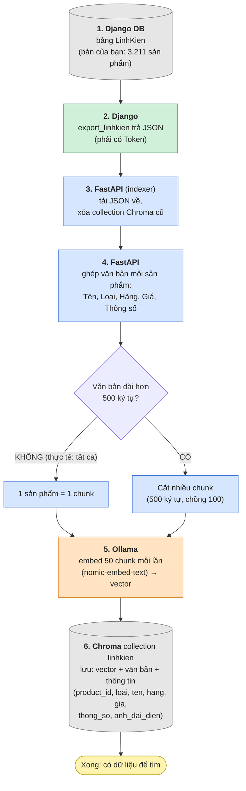
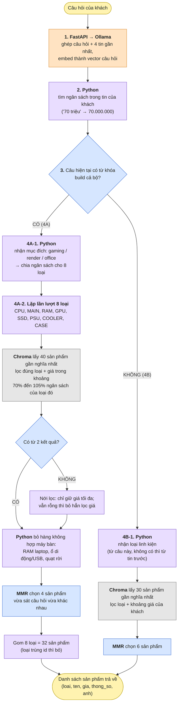
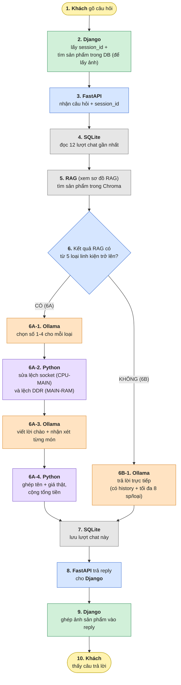

# Luồng hoạt động A–Z của chatbot tư vấn linh kiện

Tài liệu này viết lại dựa trên **code thật trên máy** (`main.py`, `retriever.py`, `indexer.py`, `embedder.py`, `store.py`, `prompting.py`, `ollama_client.py`, `chat_history.py`, `config.py`, `views.py`, `system_prompt.txt`) và hai file Chroma/SQLite đính kèm. Nó thay thế bản trước, vì bản trước có vài chỗ mô tả theo tài liệu cũ.

**Tóm tắt một câu:** Khách hỏi → Django lấy `session_id` rồi chuyển sang FastAPI → FastAPI đọc lịch sử, tìm sản phẩm bằng RAG (Chroma), rồi hoặc để AI chọn bộ linh kiện và Python ghép giá/tổng tiền (hỏi build cả bộ), hoặc để AI trả lời trực tiếp (hỏi thường) → lưu lịch sử → Django ghép ảnh → khách thấy câu trả lời.

---

## 1. Các thành phần

| Thành phần | Vai trò | Giữ gì |
|---|---|---|
| **Trình duyệt** (`store.js`) | Khung chat, hiển thị reply | Giao diện |
| **Django** (`views.py`) | Cổng vào/ra, nguồn dữ liệu gốc, ghép ảnh | DB `LinhKien`, Django session |
| **FastAPI** (`main.py`, `rag/`, `prompting.py`, `ollama_client.py`) | Bộ não: lịch sử, RAG, prompt, gọi AI | Chroma, SQLite lịch sử |
| **Ollama** | Chạy 2 model: `nomic-embed-text` (embed) và `qwen3-sale` (chat) | Model |
| **ChromaDB** (`chroma_db/`) | Kho vector, collection `linhkien`, đo độ gần bằng cosine | Vector + thông tin sản phẩm |
| **SQLite** (`data/chat_history.sqlite3`) | Lịch sử chat theo `session_id` | Các lượt user/assistant |

Màu trong các sơ đồ: vàng = khách/kết quả, xanh lá = Django, xanh dương = FastAPI, cam = Ollama (AI), tím = Python tự xử lý, xám = nơi lưu dữ liệu.

---

## 2. Sơ đồ 1: Xử lý dữ liệu (nạp sản phẩm vào Chroma)

Chạy khi bạn gọi `POST /reindex` (sau khi thêm/sửa sản phẩm). Chroma không tự cập nhật.

**Chú thích**
1. Django DB là nơi giữ dữ liệu gốc. Bản bạn gửi có **3.211 sản phẩm**, gồm 9 loại: GPU 601, CASE 583, COOLER 454, SSD 398, PSU 287, MAIN 284, CPU 237, HDD 206, RAM 161.
2. `export_linhkien` trả JSON `{id, loai, ten, hang, gia_hien_tai, tom_tat, anh_dai_dien}`, bắt buộc có header `Authorization: Token <EXPORT_TOKEN>`.
3. FastAPI tải JSON về rồi **xóa sạch collection cũ** trước khi nạp (nên reindex là nạp lại toàn bộ).
4. Mỗi sản phẩm được ghép thành một đoạn văn: `Tên sản phẩm / Loại / Hãng / Giá / Thông số`. Trường `thong_so` lấy từ `tom_tat` của Django.
5. Chỉ khi đoạn văn dài hơn 500 ký tự mới bị cắt nhiều chunk. Thực tế trong DB của bạn **mọi sản phẩm đều đúng 1 chunk** (3.211 chunk = 3.211 sản phẩm).
6. Ollama embed theo lô 50 chunk, mỗi chunk thành một vector. Chroma lưu vector + văn bản + thông tin (`product_id, loai, ten, hang, gia, thong_so, anh_dai_dien, chunk_idx`).

---

## 3. Sơ đồ 2: RAG (tìm sản phẩm cho một câu hỏi)

Đây là hàm `retrieve()` trong `rag/retriever.py`.

**Chú thích**
- **Bước 1:** văn bản đem đi embed là *câu hỏi + tối đa 4 tin gần nhất trong lịch sử* (cả khách lẫn bot), chỉ embed 1 lần cho cả quá trình.
- **Bước 2:** ngân sách chỉ đọc từ tin của **khách** (không đọc giá trong câu trả lời của bot). Hiểu "70 triệu", "tầm 70", "dưới 50", "50 đổ lại", "từ 30 đến 40 triệu". Số trần từ 1 đến 500 tự hiểu là triệu.
- **Bước 3:** chỉ xét **câu hiện tại**, các từ khóa như "build máy", "full bộ", "cấu hình", "máy tính"...
- **4A (build cả bộ):** mục đích (`gaming` mặc định / `render` / `office`) lấy từ câu hỏi + 4 tin gần nhất. Tỷ lệ ngân sách trong `retriever.py`:

| Loại | Gaming | Render | Office |
|---|---|---|---|
| GPU | 40% | 34% | 0% (bỏ qua) |
| CPU | 20% | 25% | 32% |
| MAIN | 11% | 12% | 22% |
| RAM | 8% | 12% | 16% |
| SSD | 7% | 7% | 13% |
| PSU | 7% | 5% | 9% |
| COOLER | 3,5% | 2,5% | 2% |
| CASE | 3,5% | 2,5% | 6% |

  Ví dụ "build máy chơi game tầm 70 triệu": ngân sách trần 70.000.000đ, GPU được 40% = 28.000.000đ nên Chroma chỉ lấy GPU giá từ 19.600.000đ đến 29.400.000đ (70% đến 105%). CPU 20% = 14.000.000đ nên lọc 9.800.000đ đến 14.700.000đ. Cứ thế với 8 loại. Kết quả: 8 loại × 4 = **32 sản phẩm**. Nếu khách không nêu ngân sách thì không lọc giá.
- **4B (hỏi thường):** loại linh kiện nhận theo từ khóa (card, ram, ssd, nguồn...), câu này không có thì tìm ngược trong tin trước. Lấy 30 sản phẩm gần nhất, MMR chọn **6**.
- **MMR** chọn sản phẩm vừa sát câu hỏi vừa khác nhau, tránh 4 sản phẩm gần như giống hệt.
- Nếu Chroma rỗng (chưa reindex) thì trả danh sách rỗng và ghi cảnh báo.

---

## 4. Sơ đồ 3: Luồng chính từ lúc khách hỏi đến output

### Dữ liệu đi qua từng chặng

| Chặng | Giao thức | Gửi đi | Nhận về |
|---|---|---|---|
| 1→2 Trình duyệt → Django | HTTP POST (JSON) | `message` | `{reply}` |
| 2→3 Django → FastAPI `/chat` | HTTP POST (JSON) | `message`, `session_id` | `{reply, model, session_id}` |
| 4 FastAPI ↔ SQLite | thư viện | `session_id` | tối đa 12 lượt gần nhất |
| 5 FastAPI → Ollama embed | HTTP POST `/api/embed` | văn bản | vector |
| 5 FastAPI ↔ Chroma | thư viện | vector + bộ lọc loại/giá | các chunk + thông tin |
| 6 FastAPI → Ollama chat | HTTP POST `/api/chat` | `messages`, `format`, `options` | nội dung AI sinh |
| 9 Django → Trình duyệt | JSON | `{reply}` đã ghép ảnh | hiển thị |

### Bước 2: Django
Cắt `message` còn tối đa 1000 ký tự. Lấy `session_id = request.session.session_key` (chưa có thì tạo), mỗi trình duyệt một key. Django **cũng tự chạy `search_products()`** (truy vấn ORM) để lấy danh sách sản phẩm phục vụ ghép ảnh ở bước 9, và làm phương án dự phòng.

### Bước 4: lịch sử được dùng ở đâu
Đọc 12 lượt gần nhất. Lịch sử được dùng ở **RAG** (4 tin gần nhất để embed, tìm ngân sách, nhận mục đích) và ở **nhánh 6B** (6 lượt gần nhất đưa vào prompt). **Nhánh 6A không đưa lịch sử vào prompt của AI**, nó chỉ ảnh hưởng gián tiếp qua kết quả RAG.

### Bước 6: rẽ nhánh
Điều kiện là `is_multi_type_build`: kết quả RAG có **từ 5 loại linh kiện trở lên**.

**6A: build cả bộ (hai lần gọi AI, hai lần Python)**
1. **Pick (AI):** prompt riêng "kỹ thuật viên PC", chỉ nhận câu hiện tại + danh sách đánh số `[1]..[4]` cho từng loại. AI chỉ trả JSON 8 số nguyên (`temperature 0.1`, `num_predict 120`, ép theo schema).
2. **Resolve (Python):** đổi số thành sản phẩm thật. Nếu CPU và Mainboard lệch socket (AM5/AM4/LGA1700/LGA1851...) thì thay Mainboard bằng cái cùng socket trong 4 ứng viên. Nếu Main và RAM lệch DDR4/DDR5 thì thay RAM.
3. **Notes (AI):** dùng `system_prompt.txt` + 8 món đã chốt, trả JSON gồm lời chào, nhận xét ngắn từng món, câu kết (`temperature 0.3`, ép theo schema).
4. **Render (Python):** ghép lời chào + 8 dòng `**Loại:** Tên (giá) – nhận xét` + **Tổng chi phí cộng bằng Python** + câu kết. Nếu AI trả JSON hỏng hoặc lời chào có cụm "chưa bao gồm", "dư ra"... thì dùng câu mặc định.

**6B: hỏi thường (một lần gọi AI)**
`build_messages`: system prompt + 6 lượt lịch sử (mỗi tin cắt 1000 ký tự) + danh sách sản phẩm (tối đa 8 mỗi loại) + câu hỏi → Ollama `/api/chat` (`temperature 0.4`) → `clean_reply` bỏ khối `<think>`.

### Bước 7 đến 10
Lưu 2 dòng (user + assistant) vào SQLite, mỗi session giữ tối đa 40 dòng. FastAPI trả `{reply, model, session_id}`. Django ghép ảnh: với mỗi sản phẩm trong danh sách ORM của chính nó, nếu **tên đầy đủ hoặc 3 từ đầu** xuất hiện trong reply thì thêm `` cuối reply. Cuối cùng trả `{reply}` và `store.js` hiển thị.

---

## 5. Khi có lỗi thì sao

| Sự cố | Ai xử lý | Kết quả |
|---|---|---|
| FastAPI tắt, timeout, JSON hỏng | Django (bắt `URLError, TimeoutError, KeyError, ValueError`) | Trả câu dự phòng `rule_reply()`: gợi ý 3 sản phẩm từ DB, không dùng AI |
| `retrieve()` lỗi | FastAPI | `products = []`, vẫn gọi AI (trả lời kém vì thiếu dữ liệu) |
| Chroma rỗng | `retrieve()` | Trả `[]` kèm cảnh báo "hãy gọi /reindex" |
| Ollama tắt, thiếu model, timeout | FastAPI | HTTP 503, Django rơi vào câu dự phòng |
| Reply rỗng | FastAPI | HTTP 502, Django rơi vào câu dự phòng |
| `/reindex` khi Django tắt | FastAPI | HTTP 500, Chroma giữ dữ liệu cũ (chỉ xóa sau khi tải xong) |

---

## 6. Cấu hình thật (`config.py`)

| Biến | Mặc định | Tác dụng |
|---|---|---|
| `OLLAMA_MODEL` | `qwen3-sale:latest` | Model chat |
| `EMBED_MODEL` | `nomic-embed-text:latest` | Model embed |
| `TEMPERATURE` | 0.4 | Nhiệt độ nhánh chat (pick 0.1, notes 0.3 cố định trong code) |
| `NUM_CTX` | 4096 | Ngữ cảnh (code ép tối thiểu 4096) |
| `MAX_TOKENS` | 2400 | Độ dài tối đa (pick cố định 120) |
| `KEEP_ALIVE` / `TIMEOUT_SECONDS` | 30m / 120 | Giữ model trong RAM / chờ Ollama tối đa |
| `HISTORY_FOR_LLM` | 12 | Số lượt đọc từ SQLite |
| `MAX_HISTORY_TURNS` | 6 | Số lượt đưa vào prompt nhánh 6B |
| `MAX_STORED_MSGS` | 40 | Số dòng tối đa lưu mỗi session |
| `MAX_PRODUCTS` | 8 | Số sản phẩm mỗi loại đưa vào prompt 6B |
| `RAG_TOP_K` / `RAG_FETCH_K` | 6 / 30 | Nhánh 4B: lấy 30, chọn 6 |
| `DJANGO_EXPORT_URL` / `DJANGO_EXPORT_TOKEN` | `http://127.0.0.1:8000/api/linhkien/export/` / (trống) | Nơi lấy dữ liệu để reindex |
| `CHROMA_DIR` / `CHAT_DB_PATH` | `chroma_db` / `data/chat_history.sqlite3` | Nơi lưu |

`system_prompt.txt` được đọc lại **mỗi lần gọi**, sửa file là có hiệu lực ngay, không cần restart. Một số hằng số chỉ nằm trong code (không đổi qua `.env`): 4 sản phẩm mỗi loại và lấy 40 ứng viên ở full build, khoảng giá 70%–105%, `lambda` của MMR (0,75 ở full build, 0,5 ở nhánh thường).

---

## 7. Những điểm cần để ý (rút ra từ code, không phải lỗi bắt buộc phải sửa)

1. **Tổng tiền không bị kiểm tra với ngân sách.** Python chỉ cộng giá 8 món. Ngân sách chỉ ràng buộc ở hai chỗ: lọc giá khi RAG, và lời nhắc cho AI ở bước pick. Bước pick **không nhận lịch sử**, nên nếu khách nói ngân sách ở lượt trước thì chỉ RAG biết, AI pick không biết.
2. **Công suất nguồn, kích thước case, GPU** không được Python kiểm tra, chỉ nhờ AI chọn đúng. Python chỉ khóa socket CPU–Main và DDR Main–RAM.
3. **Từ khóa build cả bộ chỉ xét câu hiện tại.** Sau khi nhận cấu hình, câu như "đổi RAM lên 32GB" thường sẽ đi nhánh hỏi thường (4B/6B), không build lại, trừ khi câu đó có từ khóa build như "cấu hình" hoặc "máy tính".
4. **Ảnh lấy từ nguồn khác với RAG.** Django tự tìm bằng ORM (ngân sách đọc bằng regex đơn giản hơn, 2 sản phẩm mỗi loại) rồi so tên trong reply. Vì hai bên tìm độc lập nên sản phẩm RAG chọn có thể không nằm trong danh sách của Django, khi đó không có ảnh.
5. **Hai bộ tỷ lệ ngân sách khác nhau:** `retriever.py` (Main 11%, RAM 8%, Cooler/Case 3,5%) và bảng trong `system_prompt.txt` (11,5% / 9% / 4%). Chỉ nhánh 6B mới đọc bảng trong `system_prompt.txt`; nhánh build dùng tỷ lệ của `retriever.py`.
6. `/reindex` báo "đã nạp N sản phẩm" nhưng thực ra N là **số chunk**. Hiện hai số trùng nhau (1 sản phẩm = 1 chunk).
